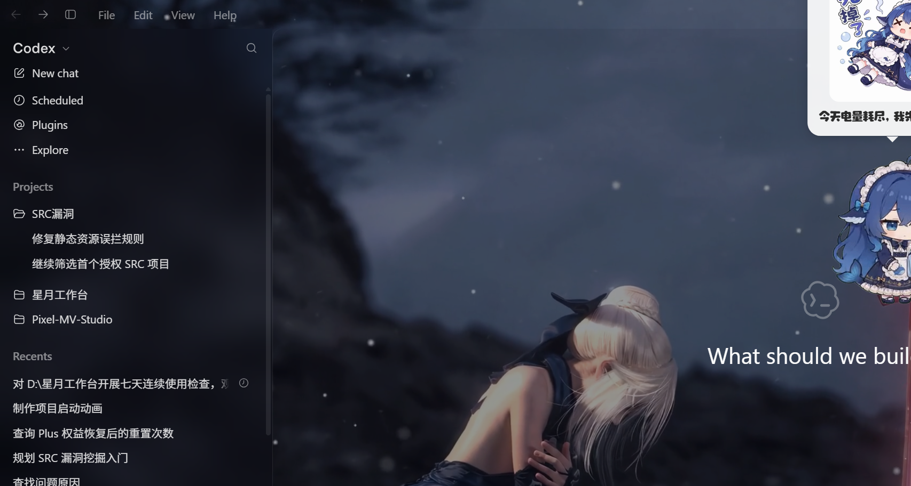

# ChatGPT 壁纸皮肤

给 **ChatGPT 桌面端**（Windows）加一层动态壁纸 + 半透明玻璃界面的小工具。

不开源项目本身的任何安装文件——它不改 `ChatGPT.exe`、不改 MSIX 包、不动签名，全部是运行时注入：
一个本地媒体服务提供视频，一个注入器通过 CDP 把「视频层 + 玻璃样式」塞进 ChatGPT 的页面。



---

## 它做了什么

- **动态壁纸**：读取你自己选的 MP4/WebM，铺满整个窗口，侧栏和对话区上面压一层半透明深蓝玻璃，正文照样清楚。
- **任意入口都生效**：开始菜单、Win+S 搜索、任务栏固定图标——随手点哪个都行。原理是守护进程发现「没带调试端口的 ChatGPT」就把它换成带端口的实例（`watchdog.ps1`，250ms 轮询）。
- **登录自启 + 保活**：开始菜单 Startup 里放一个自启项，再加一个每 2 分钟跑一次的计划任务 `ChatGPTWallpaperSkinKeepAlive`，守护进程被结束也能自己回来。
- **睡眠/唤醒自愈**：唤醒后页面里会检测视频是否还在走，不动就重载（`agent.cjs` 的 resume 检测 + 页面内看门狗）。
- **一条命令卸载**：`uninstall.ps1`，关掉进程、清掉自启和计划任务，ChatGPT 立刻恢复原样。

## 环境要求

| 项目 | 要求 |
| --- | --- |
| 系统 | Windows 10/11 x64 |
| ChatGPT | 桌面端（Microsoft Store 版的 `OpenAI.Codex` 包，含 `ChatGPT.exe`） |
| PowerShell | 5.1（系统自带）即可 |
| Node.js | 有就用现成的；没有安装器会自动下载便携版到 `runtime\node.exe` |
| 壁纸 | 你自己的视频文件（MP4 推荐 H.264、分辨率 ≤2560 宽、码率别太夸张） |

> 仓库里**不带任何壁纸素材**：Wallpaper Engine 创意工坊的内容有版权，请自备视频（自己拍的、免费素材站的、或你已购买的）。

## 安装

1. 下载本仓库（`Code → Download ZIP`），解压到任意目录。
2. 双击 **`install.cmd`**。
3. 按提示选壁纸：
   - 直接回车 → 弹文件选择框；
   - 或者先准备好路径，用命令行装：`install.cmd -Video "D:\clips\my-wall.mp4"`。
4. 装完 ChatGPT 会被重启一次并直接带上皮肤。

也可以手动指定一些参数：

```powershell
.\install.ps1 -Video "D:\clips\my-wall.mp4" -Scrim 0.25 -InstallDir "D:\Tools\GptSkin"
```

| 参数 | 说明 | 默认 |
| --- | --- | --- |
| `-Video` | 壁纸视频路径 | 交互选择 |
| `-Scrim` | 压暗程度 0~1（0 原始画面，1 全黑） | `0.22` |
| `-InstallDir` | 安装目录 | `%LOCALAPPDATA%\ChatGptWallpaperSkin` |
| `-NoAutostart` | 不建自启项和计划任务 | 否 |

## 装完之后

**照你平时的习惯打开 ChatGPT 就行**，不用记快捷方式。

首次从「不带参数」的入口打开时，会在几秒内被替换成带皮肤的实例（窗口会闪一下——这是换代，不是崩溃）。

想调外观：

- 改 `glass.css`（安装目录里）——**1.5 秒内热重载**，不用重启：
  - 内容区底色：搜 `main[class*="MainContentSurface"]`，`rgba(9,14,24,0.07)` 的最后一个数是透明度，0 完全透明。
  - 侧栏玻璃强度：搜 `#root nav`，改 `blur(18px)`。
- 改 `config.json` 里的 `scrim`：画面太亮/字看不清就调大（0.3~0.45），想让壁纸更显眼就调小（0.1~0.2）。改完重启 ChatGPT 生效。
- 换壁纸：改 `config.json` 的 `videoPath`，或者重跑一遍 `install.ps1 -Video "..."`。

### 可选：和桌面桌宠联动

如果你有桌面桌宠（比如 PySide6 写的那种），可以让它跟着 ChatGPT 一起出现：

```json
{
  "petExe": "D:\\Applications\\YourPet\\YourPet.exe",
  "petProcessName": "YourPet"
}
```

写在 `config.json` 里（`petProcessName` 可省，默认取 exe 文件名）。之后 `watchdog.ps1` 会在「ChatGPT 从没运行变成运行」的那一刻拉起桌宠一次；你手动关掉它不会被强行拉回来，下次开 ChatGPT 才再出现。

## 皮肤不见了怎么办

先跑这一个命令，它会逐项告诉你哪儿断了：

```powershell
# 安装目录里
.\doctor.ps1
```

输出长这样（每行 `[ok]` / `[!!]`，最后给结论和修法）：

```
1. config
  [ok] config.json parses (version 1)
  [ok] wallpaper exists: D:\videos\king.mp4 (9.1 MB)
2. processes and ports
  [!!] media server not listening on 8756
  [!!] injector (agent.cjs) is not running
...
VERDICT: 2 problem(s) above.
```

绝大多数情况是「后台的三个小进程掉了」，直接补起来就行：

```powershell
.\start.ps1
```

如果是壁纸文件被你移动/删了，会看到这样一句（同时写进安装目录的 `last-error.txt`）：

```
videoPath does not exist: D:\videos\king.mp4  ->  fix videoPath in config.json, or re-run install.ps1 -Video <path>.
```

改 `config.json` 的 `videoPath` 或者重跑 `install.ps1 -Video "新路径"` 即可。

> 为什么以前会「静默坏掉」：`start.ps1` 是在隐藏窗口里跑的，失败信息普通人看不见。现在任何失败都会落到 `last-error.txt`，`doctor.ps1` 也会把它念出来。

## 卸载

```powershell
# 安装目录里
.\uninstall.ps1          # 停进程、清自启和计划任务，保留文件
.\uninstall.ps1 -Purge   # 连安装目录一起删
```

卸载后重新打开 ChatGPT 就是原生界面。

## 原理（想改代码的看这里)

```
watchdog.ps1   ── 250ms 轮询 ──▶ 发现无端口实例 → kill → 用包身份 ActivateApplication(带 --remote-debugging-port)
                       │
                       ├─ 保活媒体服务 serve.cjs（HTTP Range，把大视频流式喂给页面）
                       └─ 保活注入器 agent.cjs

agent.cjs ── CDP ──▶ 每个 page target 一个 session
                       ├─ Page.setBypassCSP   （IWA 默认 CSP 会拦 127.0.0.1，必须放开）
                       ├─ Runtime.evaluate    注入 #wesk-bg / #wesk-video / #wesk-veil + <style>
                       ├─ Page.loadEventFired 重新注入（导航后不丢）
                       └─ 90s 心跳断档 → 判为刚唤醒 → 全部 reload + 重注入
```

几个绕不开的坑，已经处理了，改代码时别踩回去：

- **CSP bypass 是会话级的**：注入器一退出就失效，所以必须有常驻进程握着连接。
- **Chromium 不能给已运行的实例补 `--remote-debugging-port`**：这就是为什么要有「换实例」这套机制，而不是简单加个启动参数。
- **`Win32_ProcessStartTrace` 需要管理员**：普通权限收不到进程启动事件，所以只能轮询（250ms 的代价是几乎察觉不到）。
- **`blur()` 是 CSS 像素**：150% 缩放下 `blur(16px)` 实际会糊成一片，所以内容区不用模糊，只压一层淡色。
- **PowerShell 5.1 按 ANSI 读脚本**：仓库里所有 `.ps1` 都是纯 ASCII；要加中文注释就得存成 **UTF-8 with BOM（只能一个 BOM）**，双 BOM 会让它报「赋值表达式无效」。
- **PowerShell 5.1 也按 ANSI 读 `config.json`**：`Get-Content` 不带 `-Encoding UTF8` 会把中文用户名路径读成乱码，再写回去就把 `videoPath` 永久毁掉（本项目真踩过，坏了 13 小时）。所有读写都走 `lib.ps1` 的 `Read-SkinConfig` / `Write-SkinConfig`，别自己 `Get-Content -Raw | ConvertFrom-Json` 再 `Set-Content`。
- **`powershell.exe -WindowStyle Hidden` 仍会创建控制台**：每 2 分钟闪一次黑窗口。所以自启项和计划任务都走 `wscript.exe //nologo run-hidden.vbs <script>`（GUI 子系统宿主，没有控制台可闪）。

## 已知限制

- 冷启动时窗口会重启一次（约 3 秒），那一瞬间还没发出去的文字会丢——冷启动基本还没开始打字，实际很少遇到。
- 只支持 Store 版 `OpenAI.Codex` 里的 ChatGPT 桌面端；如果 OpenAI 换包名或换渲染框架，需要改 `config.json` 的 `appPackageName` / `appAumid`，注入部分的 DOM 选择器也可能要跟着调。
- 不保证跟 ChatGPT 的每次更新兼容（它改类名，玻璃效果就可能局部失效），坏了就把 `glass.css` 的选择器更新一下。
- 视频解码开销取决于你的片源：4K60 的片子会明显吃 GPU，建议 1440p 以内。

## License

MIT，见 [LICENSE](LICENSE)。壁纸素材版权归各自作者，仓库不附带。
